# MANUAL COMPLETO DE HARDWARE, SIMULAÇÃO E OPERAÇÃO
## Tech Arcade — Mini Console Unificado (Arduino Uno R3 + OLED 128x64)

---

## 1. Visão Geral do Projeto

O **Tech Arcade Mini Console** é uma plataforma integrada de entretenimento e demonstração tecnológica baseada no microcontrolador **ATmega328P (Arduino Uno R3)**. O projeto reúne **cinco jogos interativos completos** em um único hardware compacto, reutilizando de maneira inteligente entradas, saídas, display e recursos sonoros:

1. **Memory Master:** Desafio da memória clássico ("Genius") com 4 cores, notas musicais progressivas e recorde.
2. **Quick Draw:** Duelo de reflexos para 2 participantes com detecção de queima de largada e medição em milissegundos.
3. **Punch Meter:** Máquina de soco/força que detecta vibrações e impactos via sensor piezoelétrico analógico.
4. **Steady Hands:** Teste de coordenação motora no circuito de arame metálico condutor com sistema de vidas e cronômetro.
5. **Campo Minado:** Desafio de raciocínio e sorte com 5 posições eletrônicas e 2 minas ocultas sorteadas.

---

## 2. Layout Ergonômico do Mini Console

Para proporcionar a melhor experiência ao jogar tanto individualmente quanto em dupla (*Quick Draw*), os componentes foram organizados no formato de uma mesa de controle *Arcade*:

```text
+---------------------------------------------------------------+
|                      [ OLED 128x64 I2C ]       [ BUZZER ]     |
|                   (Placar / Menu / Feedback)     (D11)        |
+---------------------------------------------------------------+
|                                                               |
|   [LED 1]      [LED 2]      [LED 3]      [LED 4]      [LED 5] |
|  (Vermelho)    (Verde)       (Azul)     (Amarelo)    (Laranja)|
|     D7           D8           D9           D10          D12   |
|                                                               |
|   +----+       +----+       +----+       +----+       +----+  |
|   |BT 1|       |BT 2|       |BT 3|       |BT 4|       |BT 5|  |
|   +----+       +----+       +----+       +----+       +----+  |
|  Vermelho      Verde         Azul       Amarelo       Branco  |
|     D2           D3           D4           D5           D6    |
|   (P1 /        (P2 /       (Baixo /     (Direita /   (Select /|
|  Genius 1)     Cima)        Start SH)    Stop SH)     Menu)   |
|                                                               |
|   [ PIEZO IMPACTO (A0) ]              [ ARAME + ARGOLA (A1) ] |
+---------------------------------------------------------------+
```

---

## 3. Tabela de Conexões Pino a Pino (Pinout Unificado)

Todos os botões e a pista de arame utilizam a configuração `INPUT_PULLUP` interna do Arduino, dispensando resistores externos de pull-up.

| Pino Arduino | Componente Físico | Conexão Terminal 1 | Conexão Terminal 2 / Observação |
| :---: | :--- | :--- | :--- |
| **5V** | Barramento VCC | 5V do Arduino | VCC do Display OLED e Piezo |
| **GND** | Barramento GND | GND do Arduino | Barramento negativo compartilhado |
| **A4 (SDA)**| Display OLED SSD1306 | Pino SDA do display | Barramento I2C |
| **A5 (SCL)**| Display OLED SSD1306 | Pino SCL do display | Barramento I2C |
| **D2** | Pushbutton 1 (Vermelho) | Terminal A ao D2 | Terminal B ao GND |
| **D3** | Pushbutton 2 (Verde) | Terminal A ao D3 | Terminal B ao GND |
| **D4** | Pushbutton 3 (Azul) | Terminal A ao D4 | Terminal B ao GND |
| **D5** | Pushbutton 4 (Amarelo) | Terminal A ao D5 | Terminal B ao GND |
| **D6** | Pushbutton 5 (Branco) | Terminal A ao D6 | Terminal B ao GND |
| **D7** | LED 1 (Vermelho) | Resistor 220 Ω ao D7 → Ânodo (+) | Cátodo (-) ao GND |
| **D8** | LED 2 (Verde) | Resistor 220 Ω ao D8 → Ânodo (+) | Cátodo (-) ao GND |
| **D9** | LED 3 (Azul) | Resistor 220 Ω ao D9 → Ânodo (+) | Cátodo (-) ao GND |
| **D10** | LED 4 (Amarelo) | Resistor 220 Ω ao D10 → Ânodo (+) | Cátodo (-) ao GND |
| **D11** | Buzzer Passivo | Terminal Positivo (+) ao D11 | Terminal Negativo (-) ao GND |
| **D12** | LED 5 (Laranja/Branco) | Resistor 220 Ω ao D12 → Ânodo (+) | Cátodo (-) ao GND |
| **A0** | Sensor Piezoelétrico | Resistor 10 kΩ em série com A0 | Resistor 1 MΩ em paralelo c/ piezo |
| **A1** | Pista de Arame condutora | Fio conectado ao arame (D14/A1) | Argola móvel conectada ao GND |
| **A2** | Pino flutuante | Desconectado | Usado para semente aleatória genuína |
| **D0 / D1** | Porta Serial USB | Conexão direta com PC | Mantidos 100% livres para gravação e debug |

---

## 4. Diagrama Esquemático de Conexões (Mermaid)

```mermaid
flowchart TD
    subgraph ARDUINO["Arduino Uno R3"]
        A4["A4 (SDA)"]
        A5["A5 (SCL)"]
        D2["D2"]
        D3["D3"]
        D4["D4"]
        D5["D5"]
        D6["D6"]
        D7["D7"]
        D8["D8"]
        D9["D9"]
        D10["D10"]
        D11["D11 (PWM)"]
        D12["D12"]
        A0["A0"]
        A1["A1"]
        GND["GND Comum"]
        VCC["5V"]
    end

    subgraph I2C_DEV["Interface Gráfica"]
        OLED["Display OLED 128x64"]
    end

    subgraph CONTROLES["Botões de Controle (INPUT_PULLUP)"]
        BT1["BT1 (Vermelho / P1)"]
        BT2["BT2 (Verde / P2 / Up)"]
        BT3["BT3 (Azul / Down)"]
        BT4["BT4 (Amarelo / Fim)"]
        BT5["BT5 (Branco / Select)"]
    end

    subgraph SAIDAS["Sinalizadores Visuais e Sonoros"]
        LED1["LED 1 (Vermelho) + 220R"]
        LED2["LED 2 (Verde) + 220R"]
        LED3["LED 3 (Azul) + 220R"]
        LED4["LED 4 (Amarelo) + 220R"]
        LED5["LED 5 (Laranja) + 220R"]
        BUZZER["Buzzer Passivo"]
    end

    subgraph SENSORES["Sensores Especiais"]
        PIEZO["Piezo (Soco) + 10k/1M"]
        ARAME["Arame + Argola (Mão Firme)"]
    end

    VCC --> OLED
    GND --> OLED
    A4 --> OLED
    A5 --> OLED

    D2 --> BT1 --> GND
    D3 --> BT2 --> GND
    D4 --> BT3 --> GND
    D5 --> BT4 --> GND
    D6 --> BT5 --> GND

    D7 --> LED1 --> GND
    D8 --> LED2 --> GND
    D9 --> LED3 --> GND
    D10 --> LED4 --> GND
    D12 --> LED5 --> GND

    D11 --> BUZZER --> GND
    A0 --> PIEZO --> GND
    A1 --> ARAME --> GND
```



---

## 5. Como Executar a Simulação no Wokwi

O projeto já contém os arquivos de configuração prontos para simulação no **Wokwi** (`console/diagram.json` e `console/wokwi.toml`):

1. Acesse [wokwi.com](https://wokwi.com) e crie um novo projeto com **Arduino Uno**.
2. Na aba de arquivos do simulador, substitua o conteúdo do arquivo `sketch.ino` pelo código de `console/console.ino`.
3. Abra a aba `diagram.json` e substitua todo o conteúdo pelo arquivo `console/diagram.json`.
4. Clique no botão **Play / Iniciar Simulação**.
5. **Dicas para interagir no Wokwi:**
   * **Navegação do Menu:** Use o **BT2** (Verde) para subir e o **BT3** (Azul) para descer na lista de jogos.
   * **Selecionar Jogo:** Clique no **BT5** (Branco) para iniciar o jogo em destaque.
   * **Simulação de Soco (Punch Meter):** Gire o potenciômetro rotulado como `Piezo Soco (A0)` para simular a intensidade do impacto.
   * **Simulação de Toque (Steady Hands):** Clique no botão `Toque Arame (A1)` para simular o contato da argola no fio metálico.
   * **Botão de Pânico / Voltar ao Menu:** Mantenha o **BT5** pressionado por **1,8 segundos** para interromper o jogo ativo e retornar ao menu principal.

---

## 6. Instruções de Operação de Cada Jogo

### 🎮 Jogo 1 — Memory Master
* **Objetivo:** Repetir a sequência de luzes e tons musicais.
* **Controles:**
  * `BT1` = Vermelho (262 Hz)
  * `BT2` = Verde (330 Hz)
  * `BT3` = Azul (392 Hz)
  * `BT4` = Amarelo (523 Hz)
* **Regras:** A cada acerto, uma nova cor é adicionada à sequência e a velocidade aumenta. O jogo registra a pontuação máxima alcançada na sessão.

### 🤠 Jogo 2 — Quick Draw (Duelo de Reflexo 2P)
* **Objetivo:** Pressionar o botão mais rápido que o oponente após o sinal de largada.
* **Controles:**
  * Jogador 1: `BT1` (Vermelho)
  * Jogador 2: `BT2` (Verde)
* **Regras:**
  1. Cada jogador pressiona seu botão para armar a partida.
  2. Aguardem o intervalo aleatório (2 a 5 segundos).
  3. **Atenção:** Qualquer clique antes da hora desclassifica o jogador por *Queima de Largada*.
  4. Quando o display exibir **FOGO!** e o LED central acender, aperte seu botão o mais rápido possível. O vencedor e o tempo de reação em milissegundos serão exibidos na tela.

### 🥊 Jogo 3 — Punch Meter (Teste de Força)
* **Objetivo:** Atingir a superfície acolchoada do sensor piezoelétrico com o maior impacto possível.
* **Regras:** O sistema amostra o pico elétrico durante uma janela de 50 ms e calcula uma pontuação de 0 a 1000, acendendo de 1 a 5 LEDs progressivamente (níveis: *Fraco, Médio, Forte, Muito Forte e Extremo*). Há fanfarra sonora especial para novo recorde!

### 🎯 Jogo 4 — Steady Hands (Mão Firme)
* **Objetivo:** Conduzir a argola metálica do início ao fim do trajeto de arame sem encostar nele, no menor tempo possível.
* **Controles:**
  * `BT3` (Azul): Inicia a partida e aciona o cronômetro.
  * Argola encostada no arame: Perde 1 vida (sinalizada nos LEDs 1, 2 e 3).
  * `BT4` (Amarelo): Finaliza o percurso com sucesso.
* **Regras:** O jogador possui 3 vidas. Se perder as 3, o jogo declara *Game Over*. O menor tempo de percurso sem esgotar as vidas é registrado como o recorde.

### 💣 Jogo 5 — Campo Minado
* **Objetivo:** Escolher e pressionar 3 botões seguros entre os 5 disponíveis, sem detonar as 2 minas ocultas.
* **Controles:** Botões `BT1` a `BT5`.
* **Regras:** A cada rodada, o microcontrolador sorteia 2 posições com minas. Se apertar um local seguro, o LED correspondente acende e um bip de sucesso toca. Se acertar os 3 caminhos livres, vence o jogo! Se acertar uma mina, o alarme de explosão soa e todos os LEDs piscam.

---

## 7. Retorno Universal ao Menu Principal ("Panic Button")

Para garantir que o usuário ou visitante da feira nunca fique preso dentro de um jogo, implementamos uma rotina de segurança não-bloqueante:

> **Mantenha pressionado o Botão 5 (Branco / Select) por pelo menos 1,8 segundos.**
> 
> O jogo atual é interrompido imediatamente, todos os LEDs e sons são desligados com um sinal sonoro descendente, e o display OLED exibe `VOLTANDO AO MENU...`, reapresentando a lista de seleção.

---

## 8. Relatório de Uso de Memória e Recursos do ATmega328P

* **Memória Flash (Código do Programa):** ~19,4 KB consumidos (60% da capacidade total de 32 KB). Graças ao uso extensivo de `const`, macros `F()` e otimização modular de métodos.
* **Memória SRAM (Dados Dinâmicos e Variáveis):**
  * Buffer de vídeo do Display OLED: 1024 bytes.
  * Variáveis globais e instâncias dos 5 jogos: ~221 bytes.
  * **SRAM Livre para a Pilha de Execução (Stack):** **~803 bytes livres** (mais de 39% de folga na memória RAM de 2048 bytes), prevenindo qualquer risco de *stack overflow*.
